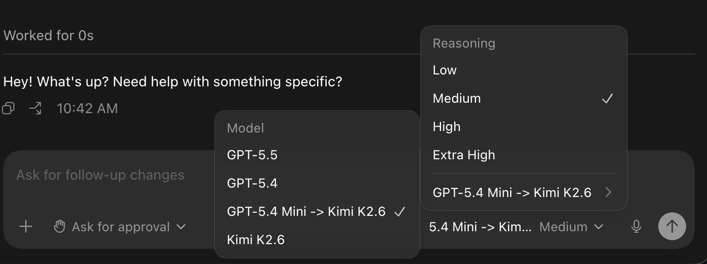

# codex-model-tap



Local mitmproxy addon for selectively intercepting Codex traffic to `chatgpt.com`, to allow local model overrides.

It does two things and leaves other traffic alone:

- Injects or overrides entries in `GET /backend-api/codex/models?...`.
- Reroutes selected `POST /backend-api/codex/responses` requests to a configured upstream endpoint, with optional model rewrite such as `gpt-5.4-mini` -> `kimi-k2.6`.
- Blocks WebSocket upgrade attempts to `/backend-api/codex/responses` so Codex can fall back to REST.

## Setup

```bash
# require Python 3.12+ for mitiproxy 12
python3 -m venv .venv
. .venv/bin/activate
pip install -e '.[dev]'
cp config.example.yaml config.yaml
# edit config.yaml as needed
```

## Run

Install/trust the mitmproxy CA for the user or system that runs Codex and run:

```bash
sudo .venv/bin/codex-model-tap --config $PWD/config.yaml --local codex
```
The helper script will run in Local Capture mode, which requires less setup on codex.

### Local Capture
Local Capture requires elevated privileges on most systems. This project targets mitmproxy 12 because it supports app-level Local Capture on Linux & macOS. Use the project helper so it selects the matching mitmdump runtime and applies the Linux local-capture compatibility setup:

```bash
sudo .venv/bin/codex-model-tap \
  --config $PWD/config.yaml \
  --local codex
```

### HTTP proxy mode

```bash
.venv/bin/mitmdump \
  --mode regular \
  --listen-host 127.0.0.1 \
  --listen-port 8080 \
  -s src/codex_model_tap/addon.py \
  --set codex_mitm_config=$PWD/config.yaml
```

Point a process at regular proxy mode with:

```bash
HTTPS_PROXY=http://127.0.0.1:8080 HTTP_PROXY=http://127.0.0.1:8080 codex
```

## Config Shape

`config.example.yaml` is intentionally model-focused. Each key under `models` is a local Codex model slug:

- If the slug does not exist in ChatGPT's catalog, set `clone_from` to copy a real catalog model and then apply your local catalog fields.
- If the slug already exists, catalog fields such as `display_name` and `description` override the original entry.
- `target_url` makes requests for that local slug route to another responses endpoint.
- `target_model` rewrites the JSON request body's `model` before forwarding.
- `bearer_token_env` names the environment variable used for the upstream Authorization bearer token.
- `headers` adds extra upstream request headers for that model.

ChatGPT host/path matching, WebSocket upgrade blocking, stripped ChatGPT headers, and local listen defaults are code-level behavior now. The config stays about models and where each model routes.

The upstream endpoint must accept the Codex responses payload shape you forward. If the upstream is OpenAI-compatible but not byte-for-byte compatible, add a transformer before forwarding.

## Background
I need a mitm-based layer because it lets me intercept Codex traffic without changing the client itself, so I can keep a clean “no history loss” provider-switch approach used by others (eg. ollama, cc-switch). That means I can route the same Codex session between my own provider and ChatGPT Codex as needed, while preserving the existing conversation state and request flow. In local capture mode, it also avoids restarting the Codex session when I change routing, which keeps the workflow fast and continuous.

## Reference
- https://localai.io/features/mitm-proxy/index.html
- https://docs.mitmproxy.org/stable/concepts/modes/#local-capture
- https://github.com/BigPizzaV3/CodexPlusPlus
- https://github.com/Soju06/codex-lb
- https://docs.ollama.com/integrations/codex-app
- https://developers.openai.com/codex/config-advanced
- https://github.com/Dailin521/codex-provider-sync
